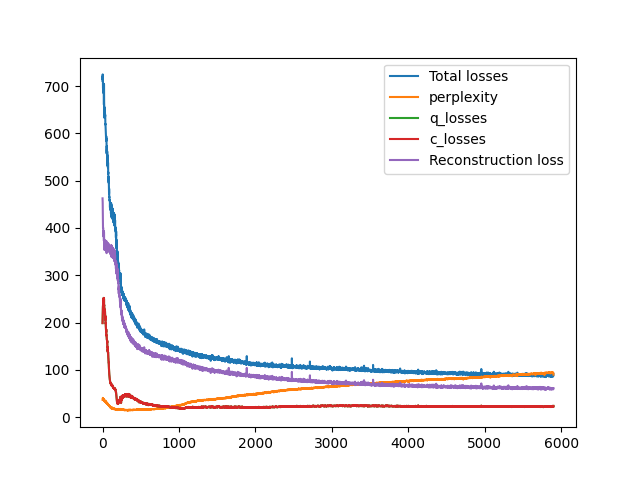
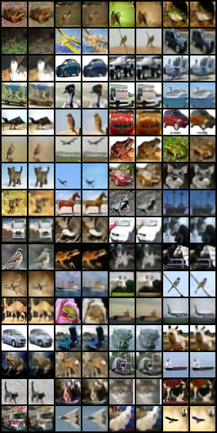

# VQVAE-CIFAR10

From-scratch PyTorch implementation of **Vector Quantised Variational AutoEncoder (VQ-VAE)** (*Neural Discrete Representation Learning*) trained on **CIFAR-10**, built as a discrete visual tokenizer foundation for world model experimentation.

## Results

### Training Curves (`losses.png`)



### Reconstructions at Epoch 50 (`epoch_50_step_100_reconstruction.png`)



## Repository Structure

- `vq_vae.py` — `Encoder`, `Decoder`, `VectorQuantizer` (straight-through estimator, codebook distances, commitment/quantization losses, and perplexity tracking), and `VQVAE` modules.
- `train_vqvae.py` — Training loop supporting single-device and multi-GPU `DistributedDataParallel` (`DDP`), `torch.compile`, checkpoint saving/loading (`vqvae_weights.pt`), sample grids, and loss plotting.
- `vqvae_weights.pt` — Saved model weights (`encoder_state_dict`, `decoder_state_dict`, `vector_q_state_dict`).
- `epoch_50_step_100_reconstruction.png` — Side-by-side ground truth vs. reconstructed CIFAR-10 samples.
- `losses.png` — Logged training loss components and perplexity over training steps.

## Getting Started

### 1. Clone and Set Up Environment

```bash
git clone https://github.com/collinsodhiambo/VQVAE-CIFAR10.git
cd VQVAE-CIFAR10
```

Install PyTorch and TorchVision matching your CPU/CUDA setup:

```bash
pip install torch torchvision matplotlib tqdm
```

### 2. Train from Scratch

Single GPU / CPU:

```bash
python train_vqvae.py --epochs 50 --batch-size 64 --lr 3e-4 --commitment-cost 0.25
```

Multi-GPU (`DDP` with `torchrun`):

```bash
torchrun --standalone --nproc_per_node=2 train_vqvae.py --epochs 50 --batch-size 64 --lr 3e-4 --commitment-cost 0.25
```

### 3. Resume or Load Saved Weights

Resume training from `vqvae_weights.pt`:

```bash
python train_vqvae.py --resume-training --checkpoint-path vqvae_weights.pt --epochs 50
```

Load weights in Python for inference or encoding frames into discrete latents:

```python
import torch
from train_vqvae import load_model
from vq_vae import VQVAE

device = "cuda" if torch.cuda.is_available() else "cpu"
model = VQVAE().to(device)
model = load_model(model, "vqvae_weights.pt")
model.eval()

x = torch.rand(4, 3, 32, 32, device=device)
with torch.no_grad():
    x_hat, q_loss, c_loss, perplexity = model(x)
```
### 4: Lessons Learned
- In the encoder model, not using Batch Normalization layers produced outputs with very large values. This caused the commitment and quantization loss to overshoot to ~50000 in the first epoch! Using batch norm stabilized the training and reduced the losses to ~300
- Furthermore, we also initialize the embedding weights to be near the encoder outputs so as to stabilize the commitment and quantization losses, further reducing it to ~200 range.
- Mixture of MSE loss and L1 loss produce images with sharper edges, as compared to MSE alone.
- I did not see a uniform codebook usage. Final training epoch had a perplexity of around 92, meaning the model only used 92 of the 256 num_embedding vectors comfortably. Perplexity is not a target to be hit, after all, CIFAR10 dataset has limited visual variety at 8x8 patches.
- Comparison with Variational AutoEncoder (standard) to be done.

## Citation

If you reference this implementation or the original VQ-VAE method, please cite:

```bibtex
@inproceedings{oord2017neural,
  title     = {Neural Discrete Representation Learning},
  author    = {van den Oord, Aaron and Vinyals, Oriol and Kavukcuoglu, Koray},
  booktitle = {Advances in Neural Information Processing Systems (NeurIPS)},
  volume    = {30},
  year      = {2017}
}
```

## License

This project is licensed under the MIT License — see the [LICENSE](LICENSE) file for details.
